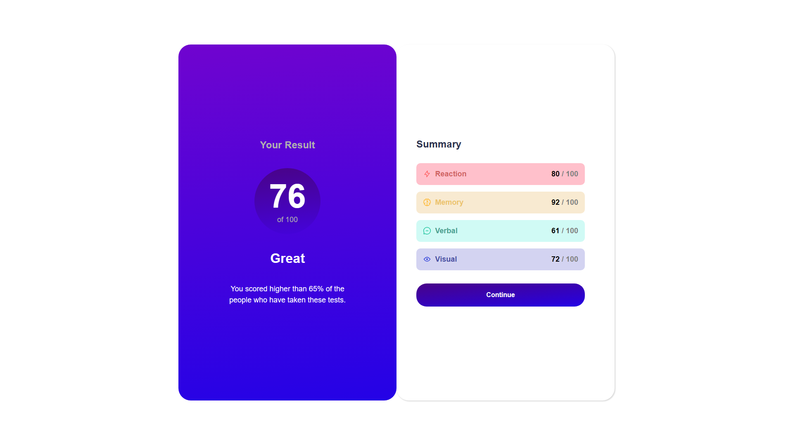
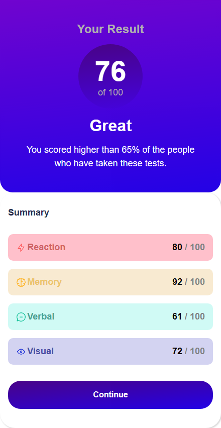

# Results Summary

A results summary card built with HTML & CSS — responsive for mobile and laptop.

Practice project.

## Preview

### PC

### Mobile

## About

"Your Result" card with a score circle (76 of 100), a summary of Reaction, Memory, Verbal and Visual scores, and a Continue button. On mobile (max-width 440px) the layout stacks vertically: the result card on top, the summary below.

## What I learned

- **Responsive with a media query:** `@media (max-width: 440px)` changes the layout on small screens — `flex-direction: column` stacks the two cards, and the circle gets smaller (8rem instead of 10rem).
- **One h1 per page:** the page has only one main title ("Your Result"). The score 76 is a `
`, and "Summary" is an `<h2>`.
- **Fixed heights cause overflow:** 4 rows of 25% height + gaps is more than 100%, so the last row overflows. Using `height: auto` with `padding` lets each row take the size of its content.
- **One class for repeated styles:** the 4 score rows shared the same flex and gap, so they use one `.left-value` class, and only the text colour changes per row.
- **A duplicate declaration is dead code:** when the same property is written twice, the second one wins and the first is ignored (e.g. two `color` or two `width` in the same rule).
- **A broken rule is ignored by the browser:** an unfinished value like `height: ';` does nothing — the browser skips the whole rule.
- **Gap is space too:** a big `gap` (4.9rem) between elements can push content out of its card on a smaller screen.
- **Text width on mobile:** a paragraph at 55% width is too narrow on a phone — 80% reads better.

## Tech

- HTML
- CSS (Flexbox, media query)

## How to open

Open index.html in your browser.
